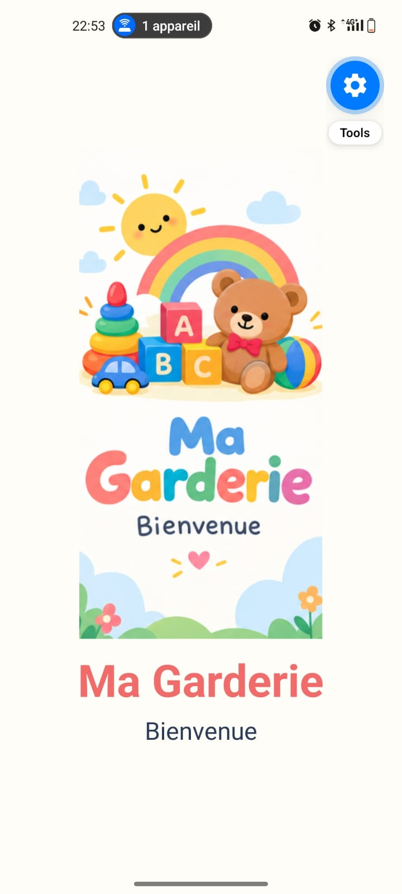
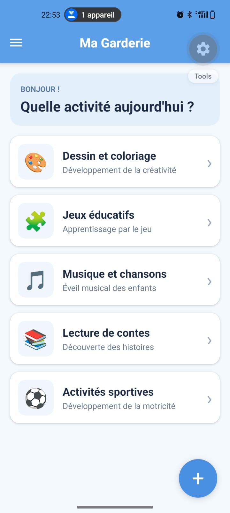

# Ma Garderie

Application mobile pour une garderie d'enfants : un splash screen, une page principale avec la liste des activités, un menu latéral (Drawer) et quelques interactions. Les données sont déclarées localement dans le code, sans backend.

## Technologies utilisées

- React Native avec Expo
- React Navigation (Stack et Drawer)
- Git et GitHub

## Installation et exécution

```bash
git clone https://github.com/oumaimasta/garderie-mobile.git
cd garderie-mobile
npm install
npx expo start
```

Scanner ensuite le QR code avec l'application **Expo Go**, ou appuyer sur `a` pour lancer un émulateur Android.

## Captures d'écran

### Splash Screen


### Page principale avec la liste des activités


### Drawer ouvert


### Message affiché après une interaction
